# bbMusic

macOS 上的 QQ 音乐播放器：原生 SwiftUI，用 Last.fm 记录听歌。

一个窗口、三个区域、没有广告位和直播入口。曲库来自 QQ 音乐，**QQ 音乐享有所有内容的版权**；播放记录交给 Last.fm。

界面跟随图标：深林绿的侧边栏 + 暖纸白的内容区，浅色与深色外观各一套。

| 浅色 | 深色 |
|---|---|
| 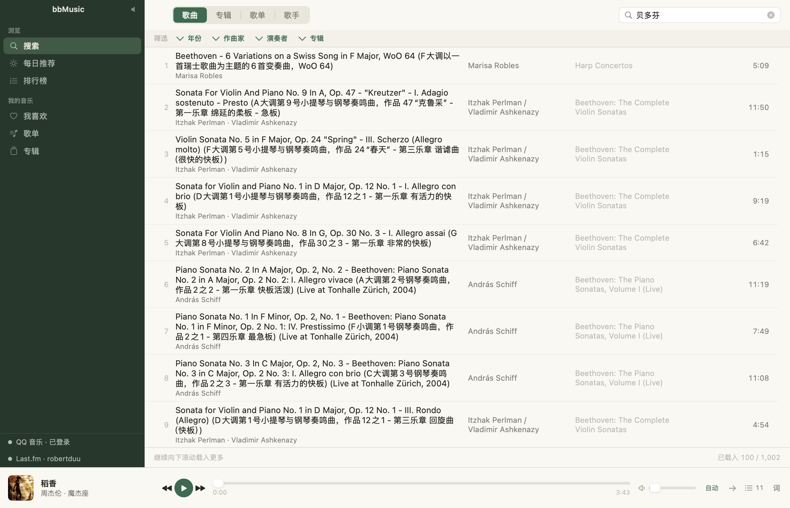 | 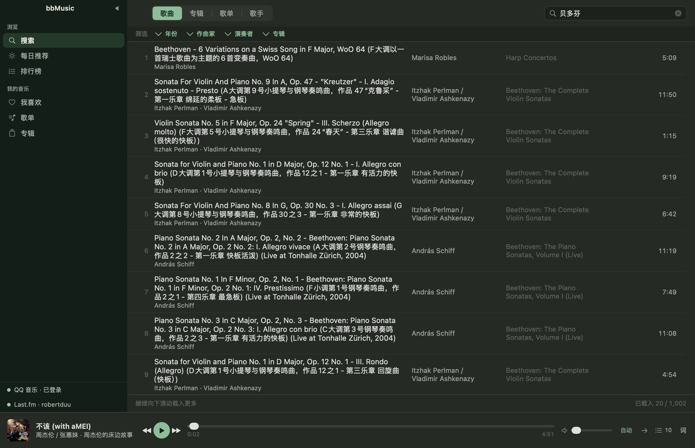 |

## 注意

**本项目与腾讯或 QQ 音乐没有隶属、授权或合作关系。** 使用时请遵守平台条款和内容授权要求。

**当前代码仅供学习，不可做商业用途。**

如果官方认为侵权，发送 Email 至 `robertduu+AT+gmail+DOT+com` 即可关闭该仓库。

## 功能

### 曲库与发现

| | |
|---|---|
| **搜索** | 歌曲 / 专辑 / 歌单 / 歌手四类分别搜索；结果逐页流式加载（一页到就显示一页，滚到底自动取下一批）；可按年份、作曲家、演奏者/乐团、专辑本地筛选 |
| **每日推荐** | 账号的 30 首每日推荐（上游固定集合，不支持翻页） |
| **排行榜** | 24 个榜单，分地区榜 / 特色榜 / 全球榜；进榜看曲目（标题右侧是榜单总数），滚到底加载下一批；底部常驻 `已载入 N / M`，翻完显示「已全部载入」 |
| **我喜欢** | 红心歌曲列表，可直接取消红心 |
| **歌单** | 自建与收藏的歌单，格子展示；详情页显示创建者、曲目数、播放/评论数、创建时间、标签与简介，简介下方可「播放歌单」，并可一键收藏/取消收藏 |
| **专辑** | 收藏的专辑，格子展示；详情页显示发行日期、唱片公司、流派、语种与简介，简介下方可「播放专辑」，并可一键收藏/取消收藏 |

### 窗口

| | |
|---|---|
| **外观** | 设置里可选跟随系统 / 浅色 / 深色（只影响 bbMusic，不改系统设置），选择会被记住 |
| **自绘顶栏** | 不用系统标题栏：侧边栏绿板延伸到窗口顶端，红绿灯悬浮其上，app 名写在绿带上，拖它即可移动窗口。内容区顶部不重复页面名（侧边栏选中态与各页头部已经说明） |

### 播放

| | |
|---|---|
| **播放控制** | 播放/暂停、上一首/下一首、进度拖动、音量、播放模式（顺序/全部循环/单曲循环）。播放条每个控件悬停有淡底，停 100ms 浮出文字（带当前状态） |
| **音质** | 只列出**当前歌曲真实存在**的档位与文件大小（128K / 320K / AAC / FLAC / APE），切换时保留播放位置；播放条显示上游实际给出的格式 |
| **队列记忆** | 队列、当前曲目与位置会存到磁盘；重开 App 队列还在、定位到上次那首，**但不自动播放**，按播放从原位置继续 |
| **曲目行** | 单击即选中，不等双击判定（实测 0.1–0.3ms）；歌手与专辑列都是链接，指针在其上变小手；悬停出现 ▶ 播放 / ⓘ 详情 / ♡ 红心，停 100ms 浮出文字说明；右键菜单有播放、详情、红心、歌手、专辑。**没有双击**——播放是按钮和菜单项。ⓘ 详情只展示这一行，**不会开始播放、也不改队列** |
| **播放队列** | 播放条最右侧打开，双击跳到某首、右键移除、清空。队列行与其他列表一致：专辑、可点的歌手、可直接红心；**正在播放的那一行最显眼**（强调色底 + 小喇叭），切歌时高亮跟着走。双击任何列表里的歌都以该列表入队，**只有搜索结果例外——播一首歌会把它的整张专辑按专辑顺序入队** |
| **歌词** | LRC 滚动高亮，有翻译时一并显示；整窗切换，播放条常驻。播放条右侧「词」按钮与 ⌘L 都是开关 |
| **歌曲详情** | 头部「播放」按钮与列表里该行的 ▶ 同义（搜索页的歌曲播整张专辑，其余播当前列表）；点播放条左侧（封面/标题/歌手）进入当前曲目的详情页：封面、歌名、歌手、专辑、年份、唱片公司、时长、实际交付音质与文件大小、发行时间、流派、语种，古典曲目另有作曲/作品/碟号，以及平台简介（整段显示，页面滚动）；再点一次收起（⌘D 等效）。**多位歌手拆开逐个可点，点了按名字搜该歌手；专辑名可点进专辑页**。接口没给的字段整行不显示。在详情页点队列按钮直接看队列，队列页无返回按钮，再点即回 |
| **古典友好** | 专辑接口提供结构化古典数据（作曲家、作品、碟号）时优先使用；没有时从标题推导作品号（`Op.` / `BWV` / `KV` / `Hob.` / `D.` / `RV` / `WoO` / `S.`，含 `No. 2` 子编号）；古典曲目显示两行，多碟专辑按碟分组 |

### 导航

| | |
|---|---|
| **详情页** | 歌手 / 专辑 / 歌单 / 榜单从任何列表进入都不改侧边栏选中态，标题与收藏按钮只描述当前这一页 |
| **返回** | 逐层退回（歌手 → 专辑 → 返回 → 歌手 → 返回 → 来的列表），回到的是原来那张列表；侧边栏点当前栏目回到该栏首页 |
| **从行内打开专辑** | 曲目行里的专辑名可点；打开后回填接口给的真实名称、歌手、曲目数与年份，收藏进账号的是完整专辑 |

### 账号与记录

| | |
|---|---|
| **QQ 音乐登录** | 扫码登录（QQ 音乐 App / 手机 QQ / 微信），登录态加密落盘，重启不用重扫 |
| **红心与收藏** | 歌曲红心、收藏专辑、收藏歌单，立即写回 QQ 音乐账号；成功给短提示，失败回滚并说明原因 |
| **Last.fm** | 浏览器内授权；开播发 now-playing；按官方规则记录（曲目 > 30 秒且播满一半或 4 分钟，时间戳取开播时刻）；断网排队，恢复后补交；超过 14 天丢弃 |
| **设置窗口** | `⌘,` 管理两个账号的登录状态与 MCP token |

### 给大模型用

内置本地 MCP 端点，运行中即可被 LLM 客户端调用：

```
地址:  http://127.0.0.1:43119/
认证:  Authorization: Bearer <token>   ← 设置 → MCP 里复制
```

17 个工具：

| 类别 | 工具 |
|---|---|
| 搜索与播放 | `search_music`、`play_track`、`playback_control`、`now_playing`、`track_qualities`、`lyrics` |
| 库读取 | `list_playlists`、`playlist_tracks`、`list_albums`、`liked_songs` |
| 发现 | `daily_recommendation`、`toplists`（可列出 24 个榜单，也可指定 id 直接播） |
| 收藏（写） | `like_track`、`collect_playlist`、`uncollect_playlist`、`collect_album`、`uncollect_album` |

可以直接对模型说「放一首稻香」「把这张专辑收藏了」「放今天的每日推荐」「放内地榜」。写操作有三条规矩：**声明目标状态而不是翻转**（重试不会把红心翻回去）、**已是目标状态即成功且不重复写**、**失败如实回报**。能力边界刻意收窄——不能改歌单内容、不能删除、不碰 Last.fm。只监听回环地址，无 token 一律 401。

## 截图

| 每日推荐 | 排行榜 |
|---|---|
| 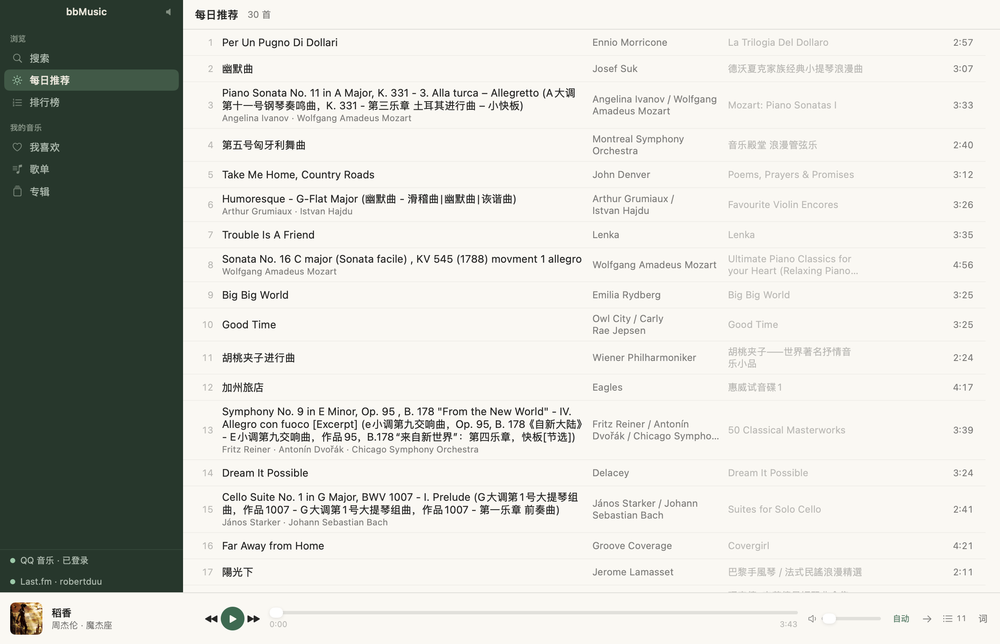 | 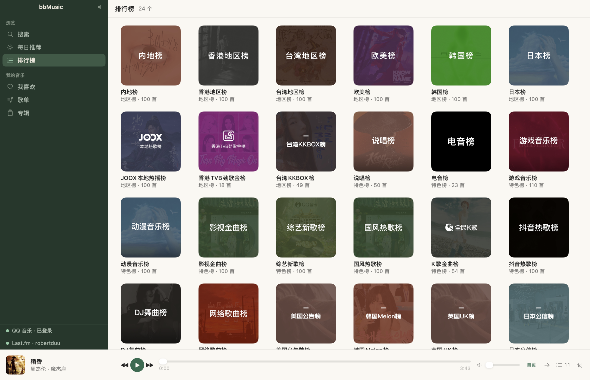 |

| 榜单曲目 | 歌手详情 |
|---|---|
| 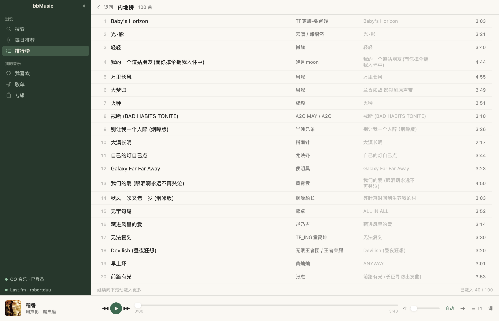 | 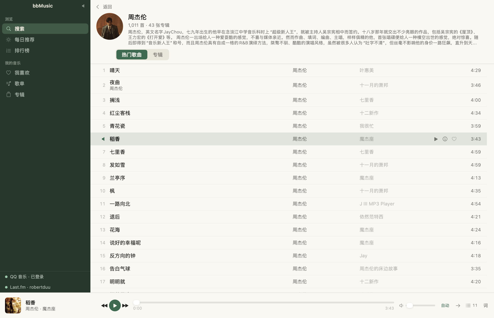 |

| 歌单 | 专辑 |
|---|---|
| 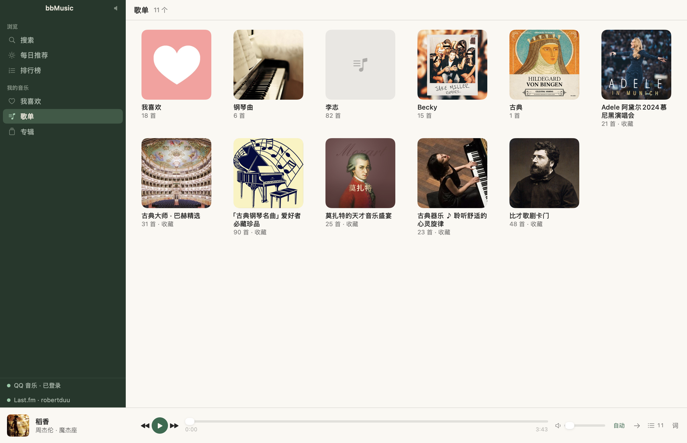 | 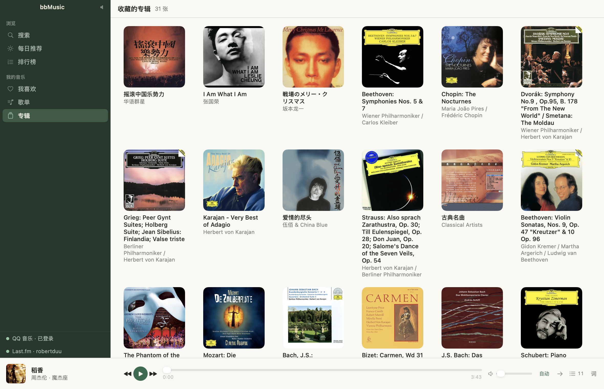 |

| 我喜欢 | 古典专辑 |
|---|---|
| 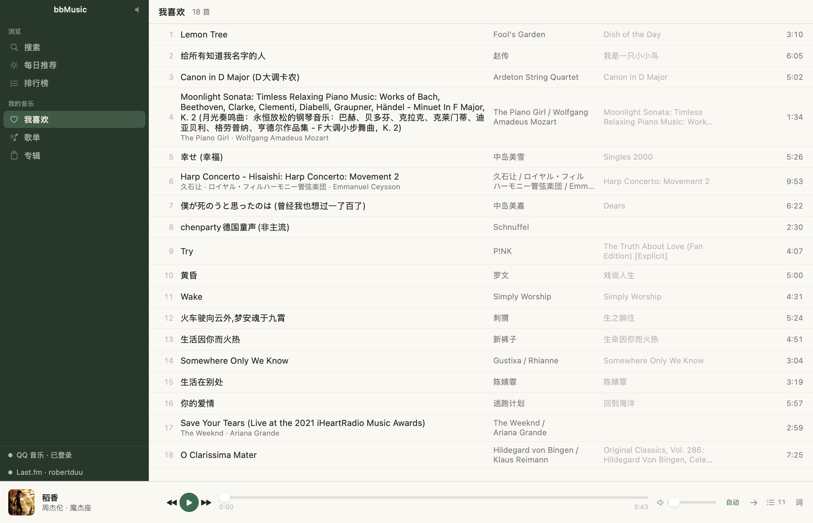 | 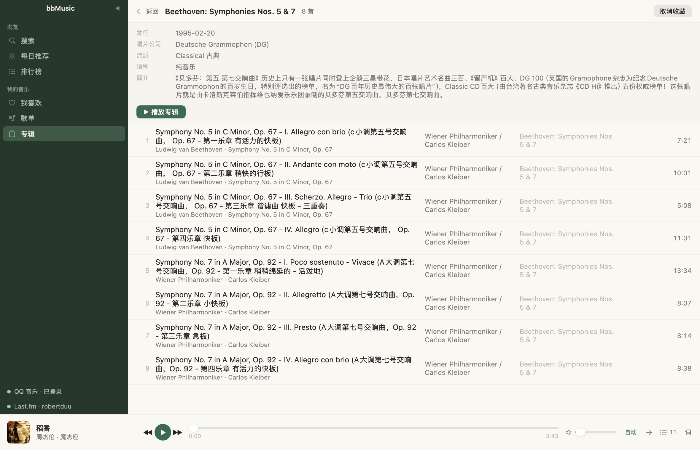 |

| 播放队列 | 歌词 |
|---|---|
| 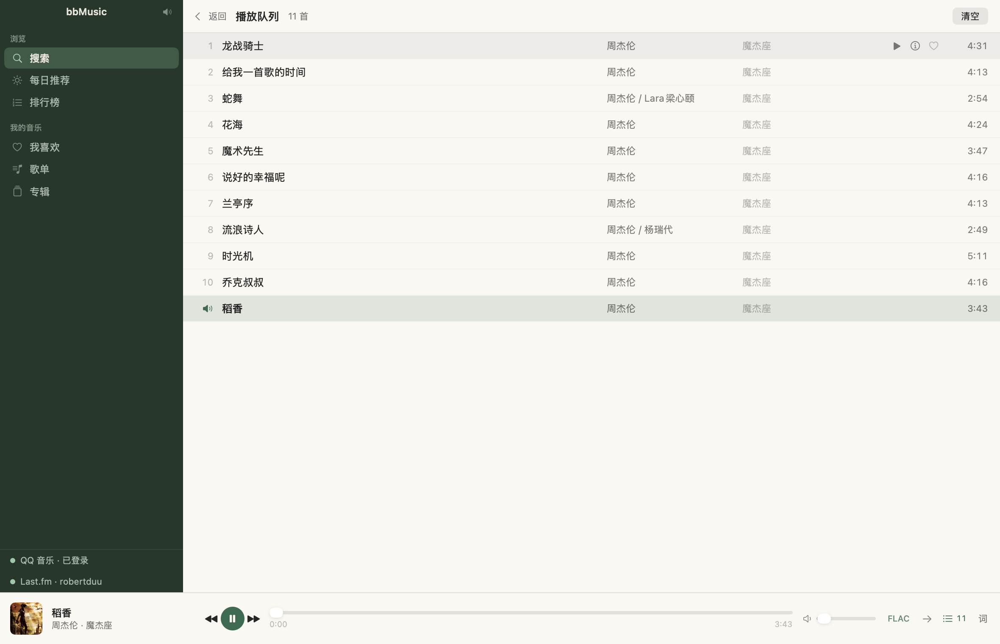 | 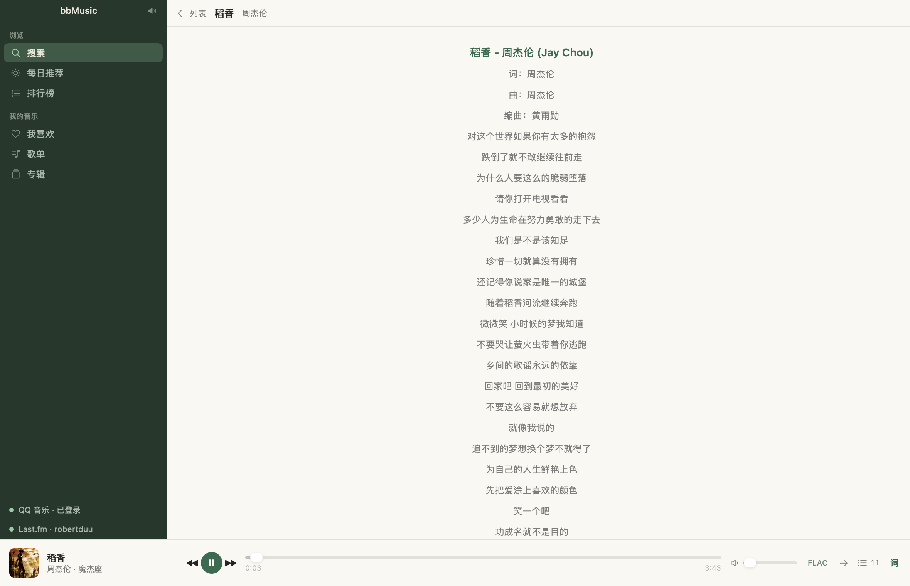 |

| 歌曲详情 | 悬停提示 |
|---|---|
| 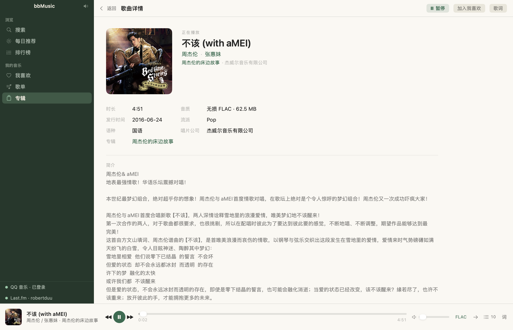 | 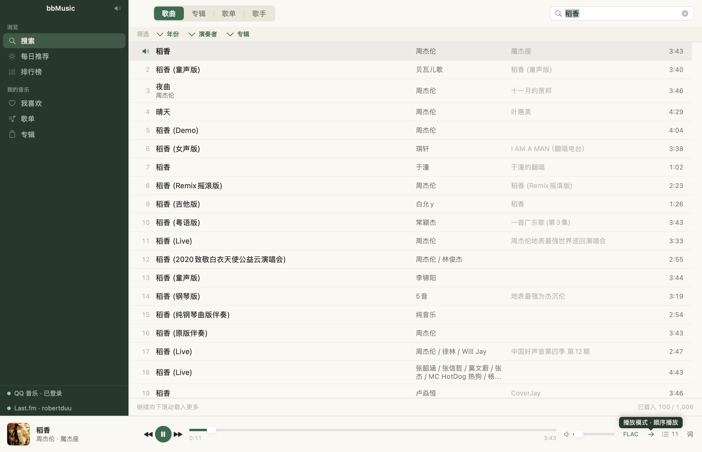 |

截图由 App 自己渲染导出，可复现：

```sh
./dist/bbMusic.app/Contents/MacOS/bbMusic --capture-screenshots docs/screenshots
./dist/bbMusic.app/Contents/MacOS/bbMusic --appearance dark --capture-screenshots docs/screenshots/dark
```

## 构建与运行

需要 macOS 14+、Xcode 命令行工具、Node 20+（仅构建时用来装依赖；运行时不依赖系统 Node）。

```sh
# 1. 安装 sidecar 依赖（只需一次）——拉的是 @yakult-green-tea/qq-music-api
cd sidecar && npm install && cd ..

# 2. 组装 .app（内嵌 Node 运行时与 sidecar）
./Scripts/build-app.sh

# 3. 打开
open dist/bbMusic.app
```

`NODE_BIN=/path/to/node ./Scripts/build-app.sh` 可指定要内嵌的 Node。

图标源在 `Assets/icon/AppIcon.svg`，由 `Scripts/make-icon.py` 生成（需要 `brew install librsvg` 提供 `rsvg-convert`）；构建只是把已提交的 `AppIcon.icns` 拷进 bundle，平时改图标才需要跑它。

## Last.fm

应用身份（API key + shared secret）**不在仓库里**——shared secret 足以冒充本应用签名，所以只存本地文件（0600）。每台机器跑一次：

```sh
./Scripts/seed-lastfm.sh     # 交互输入，或 LASTFM_API_KEY=... LASTFM_SECRET=... ./Scripts/seed-lastfm.sh
```

然后在 App 里点侧边栏底部的「连接 Last.fm」，浏览器确认即可（desktop token 流程，不需要回调地址）。

## 自检

界面无法从终端直接观察，所以有一条无头自检，在真实 bundle 内跑真实链路：

```sh
./dist/bbMusic.app/Contents/MacOS/bbMusic --self-test
```

逐步输出 `PASS`/`FAIL`，退出码即结果。覆盖：sidecar 启动、登录态、搜索与分页、四类搜索、库读取、专辑/歌单/歌手、古典推导、播放与音质、每日推荐、排行榜翻页、详情页逐层返回、搜索结果按专辑入队、红心写入往返、MCP 端点（含写工具是否齐全）、Last.fm 凭据与记录规则。自检会真的出声，所以统一把音量压到 2%。

还有一条延迟探针，在真实窗口里量单击到选中的时间（超过 50ms 即失败）：

```sh
./dist/bbMusic.app/Contents/MacOS/bbMusic --click-probe
```

单元测试覆盖不需要网络的逻辑（导航栈、入队规则、MCP 写操作契约、单击延迟）：

```sh
swift test
```

截图是同一套办法：`--capture-screenshots` 在 App 内渲染每一页，`--appearance dark` 让同一组页面在深色外观下再跑一遍——不需要改动系统外观设置。

自检与截图都会真的出声，所以两者都把音量压到 **2%**——几乎听不见，也是「这是一次测试」的信号。

## 未登录时

QQ 音乐匿名只能拿到 30 秒试听，完整播放需要登录。播放条会标注「试听 30 秒」，不会假装是完整曲目。

## 已知限制

- **只做 macOS**，不上架 App Store，不做自动更新。
- **每日推荐不能翻页**：上游固定返回 30 首，`offset` / `limit` 被忽略。
- **厂牌与指挥不做筛选**：QQ 音乐搜索响应没有这两个字段，用正则从描述里猜会给出不可靠的结果。
- **下架曲目无法播放**：版权下架后上游会抹掉 `mid` 与 `album.mid`，这类歌单（例如「李志」）没有封面也播不了。
- **ad-hoc 签名**：媒体键与部分系统集成未验证。

## 致谢

曲库能力全部来自这个包，没有它这个 App 不存在：

**[`@yakult-green-tea/qq-music-api`](https://github.com/yakult-green-tea/qq-music-api)**（v3.3.5，MIT）——非官方的 QQ 音乐 API，扫码登录、个人音乐库、播放链接、歌词与音质都出自它。bbMusic 只是在它外面套了一层原生界面与播放器。

它自身基于 **[Rain120/qq-music-api](https://github.com/Rain120/qq-music-api)**（原作者 [Rain120](https://github.com/Rain120)），当前由 yakult-green-tea 维护并发布到 npm；`chthollyphile`、`lantudou` 等贡献者的改动记录在该包的 `ATTRIBUTION.md` 里。

许可与责任：这个包是 MIT，本仓库不内联它的源码，只在 `sidecar/package.json` 里声明依赖（锁在 3.3.5），构建时由 npm 装进 `Contents/Resources/sidecar/node_modules` 随包分发，它自己的 `LICENSE` 与 `ATTRIBUTION.md` 一并保留。它调用的是逆向出的 QQ 音乐接口，随时可能失效；使用范围与责任见开头的[注意](#注意)。

## 文档

- [`goal-and-requirements.md`](goal-and-requirements.md) — 产品目标、能力范围、非目标
- [`architecture-design.md`](architecture-design.md) — 拓扑、模块边界、不变量、已实测的上游约束
