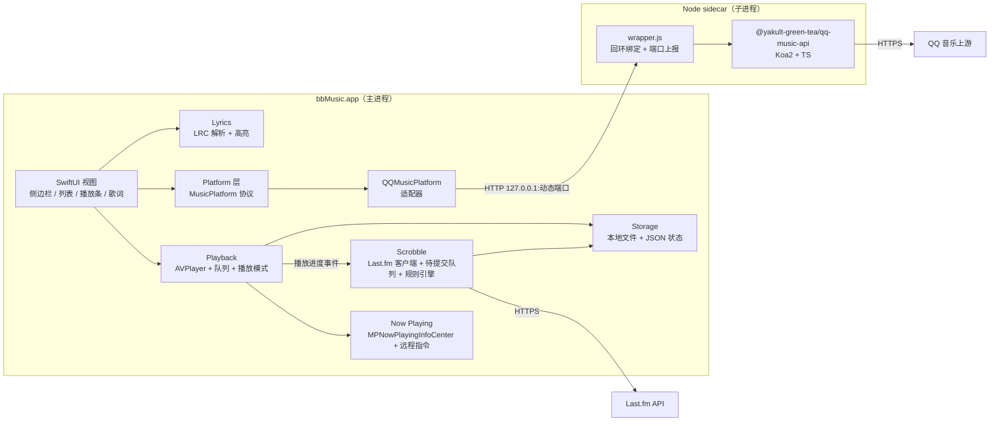

# bbMusic 架构设计

一个 SwiftUI 应用 + 一个只监听回环地址的 Node sidecar，把「QQ 音乐曲库」和「Last.fm 记录」缝在一起。核心取舍：**播放器与队列不认识任何平台，平台适配器不认识任何界面。**

## 拓扑

## 进程与端口

**主进程**持有全部用户可见状态：界面、播放、队列、歌词、scrobble 队列。它是唯一会崩溃后需要恢复用户感知的进程。

**sidecar** 只做一件事：把 QQ 音乐上游的逆向接口翻译成 HTTP JSON。它无界面、无用户状态，可以随时被杀掉重启。

sidecar 的实质是 [`@yakult-green-tea/qq-music-api`](https://github.com/yakult-green-tea/qq-music-api)（MIT，锁 3.3.5）加一层 `wrapper.js`——QQ 音乐的全部接口知识都在那个包里，本项目只做回环绑定、会话持久化接线与端口上报（下面三条）。它自身基于 [Rain120/qq-music-api](https://github.com/Rain120/qq-music-api)，`ATTRIBUTION.md` 记录完整来源。许可要求保留版权声明，因此 npm 装的 `LICENSE` / `ATTRIBUTION.md` 随 `node_modules` 一起进 bundle，`build-app.sh` 不做裁剪。

三个具体约定：

1. **回环绑定 + 动态端口。** 上游包在导入时就 `app.listen(port)`，且不指定 host——即绑定所有网卡（实测为 `::`）。本项目用自带的 `wrapper.js` 作为 sidecar 入口：设 `NODE_ENV=test` 让上游跳过自己的 `listen()`（此时它导出的 `server` 为 `null`），再对默认导出的 Koa app 执行 `listen(0, '127.0.0.1')`，得到回环 + 系统分配的空闲端口，并向 stdout 打印一行 `BBMUSIC_PORT <n>`。主进程读这一行拿端口，因此不存在端口冲突，局域网也无法访问该服务。
   两个实现约束：上游在导入时用 zod 校验 `PORT > 0` 且校验失败即退出，所以**不能**传 `PORT=0`（由 wrapper 自己绑 0，并清掉继承来的 `0`）；`NODE_ENV` 必须在 `require` 之前赋值，上游在导入时读取它。
2. **会话存活靠文件，不靠进程。** sidecar 以 `QQ_SESSION_SECRET` + `QQ_AUTH_SESSION_PATH`（指向 `~/Library/Application Support/bbMusic/`）启动，登录态加密落盘。sidecar 崩溃重启后不需要重新扫码。
   **两个都必须做，缺任一个登录就是假的**：上游被 `require` 时**不会**自己安装持久化仓库，必须由宿主显式调用 `configureAuthSessionRepository(createConfiguredAuthSessionRepository(env))`，否则会话仓库留在内存、恢复 0 条，所有需登录的接口回 401；同时扫码 `803` 时上游通过 `Set-Cookie: qqmusic_session=<token>` 下发会话令牌，无 cookie 存储的 `URLSession` 会静默丢弃它，主进程必须从响应头取出、落盘（0600）并在每次请求带上 `X-QQ-Session`。
3. **崩溃恢复。** 主进程持有子进程句柄；非正常退出时按指数退避重启（1s / 2s / 5s，连续 3 次失败则向界面报错并提供「重试」），重启期间界面显示「服务未就绪」而不是空白列表。

**Last.fm 不经过 sidecar**：只有 4 个端点，直接在主进程用 `URLSession` 调用，省一个进程的复杂度。

## 模块边界

| 模块 | 负责 | 明确不做 |
| --- | --- | --- |
| `UI` | 侧边栏导航、列表渲染、播放条、歌词视图、空/加载/错误状态 | 不直接发网络请求，不持有 `AVPlayer` |
| `Playback` | 队列、当前曲目、播放模式、进度、音量、失败重试 | 不知道曲目来自哪个平台，不做网络请求 |
| `Platform` | 平台无关模型（`Track` / `Playlist` / `Lyrics`）、`MusicPlatform` 协议、sidecar 生命周期 | 不碰界面、不碰 `AVPlayer`、不碰 scrobble |
| `QQMusicPlatform` | 把 QQ 音乐响应映射为统一模型；扫码登录流程；红心写回；取流地址 | 不决定「播放什么」，只回答「怎么拿到它」 |
| `Scrobble` | Last.fm 授权、now-playing、播放判定（官方规则）、待提交队列持久化 | 不控制播放，只观察播放进度 |
| `Lyrics` | LRC 解析（含翻译行）、按时间定位当前行 | 不拉取歌词，由 `Platform` 提供 |
| `Storage` | 本地凭据文件（Last.fm API key / secret / session）、应用状态文件、目录约定 | 不含业务判断；**不访问钥匙串** |

**依赖方向**：`UI → Playback / Platform / Lyrics`，`Playback → Platform`（只为取流地址），`Scrobble → Storage`。没有任何模块反向依赖 `UI`。`QQMusicPlatform` 是唯一知道 QQ 音乐存在的地方——换成 Spotify 时它整体替换，其余模块不变。

**配色是 `UI` 内部的一层**：`Theme.swift` 定义浅色/深色两套 `Palette`（内容底色、输入框、筛选条、播放键、强调色、侧边栏面板），由 `RootView` 按 `colorScheme` 解析一次，通过 `EnvironmentValues.palette` 往下传。视图不再直接写 `Color.accentColor` 或 `NSColor` 系统色——那些不跟随主题。侧边栏的文字色单独一套：它坐在深绿底上，系统的 `.secondary` / `.tertiary` 在浅色外观下会解析成深灰，读不出来。

## 数据流：播放一首歌

1. 用户在列表里点一首 → `Playback` 把它设为当前曲目，并把列表其余部分作为队列（`Playback` 是队列的唯一真相）。
2. `Playback` 向 `Platform` 要取流地址：`streamURL(for:quality:)` → `QQMusicPlatform` 调 `/getMusicPlay/:songmid?quality=best`。
3. 拿到 URL 后创建 `AVPlayerItem` 播放；同时更新 `MPNowPlayingInfoCenter`（标题、歌手、专辑、封面、时长）。
4. 播放进度事件喂给 `Scrobble`：开播即发 now-playing；达到阈值（见下）记一条待提交记录。
5. 同时 `Platform` 拉 `/getLyric` → `Lyrics` 解析；用户切到歌词视图时按 `currentTime` 高亮。

**取流失败的处理**：`url_unavailable` 等 `restriction` 直接作为可读提示呈现（「这首歌暂时无法播放」+ 可能原因），不静默跳下一首。

**媒体 URL 必须是 https。** QQ 音乐返回的是 `http://` 媒体地址。AVFoundation 把媒体加载放在独立进程里，**App 自己的 App Transport Security 例外对那个进程不生效**，所以纯 http 资源在任何 `.app` 内都以 `-1022` 失败——已实测：同一 URL 在裸命令行二进制里能播、在 bundle 内不能播，而它的 `https` 孪生地址两边都能播。CDN 本身支持 TLS，因此适配器统一把 scheme 升级为 https，而不是放宽传输安全。这也是「本地转发降级」方案被否掉的原因：转发本身也会是 http。

## 关键不变量

- **队列是唯一真相。** 播放列表、当前曲目、播放模式全部由 `Playback` 的队列状态推导；界面任何一处都不得自行维护「正在播放的是哪首」的副本。
- **一条播放记录只提交一次。** 待提交记录的幂等键是 `(平台, 曲目 ID, 开始播放时间戳)`；重试与补交都按这个键去重，因此重启、断网重连都不会产生重复 scrobble。
- **scrobble 判定跟随 Last.fm 官方规则**：曲目长于 30 秒，且播放满 50% 或 4 分钟（取先到者）。不满足则丢弃，不做「凑数」提交。
- **补交有时间上限**：Last.fm 不接受超过 14 天的记录（官方未写入文档，社区与官方回复一致）。待提交队列按此裁剪，过期条目丢弃并在诊断日志里留下一条，绝不假装成功。
- **界面状态可从状态推导。** 侧边栏选中项、列表内容、播放条、歌词高亮都由「当前导航（section + 路由栈）+ 队列 + 当前曲目 + 加载状态」决定，不存在只能由某次点击写入的隐藏标志。
- **详情页只描述自己。** 一个页面的标题、收藏按钮、列表内容、是否分页，全部读自路由栈顶那一层；任何「上一次浏览留下的字段」都不得参与渲染。写操作（红心/收藏）失败必须在当前页可见，不能只在一个页面里报错。
- **scrobble 的“成功”以 Last.fm 的正文为准，不以 HTTP 状态为准。** Last.fm 在被忽略时同样返回 `200`，正文里是 `@attr.ignored` / `@attr.accepted`。把 `200` 当成功会把没提交上去的记录从队列里删掉，造成静默丢失。
- **只有 Last.fm 真正收下的记录才出队。** `accepted` 与 `ignored` 都算「已了结」（ignored 是永久性拒收，重试不可能成功），其余留在队列里等下次。
- **试听不算播放。** 30 秒试听既不发 now-playing 也不记 scrobble——它会把「听了半首歌」写成假记录。
- **平台能力差异显式呈现。** 导航固定不随平台变化；未登录或平台不支持时，对应位置显示明确文案（如「需要先登录 QQ 音乐」「此平台暂不支持每日推荐」），不隐藏入口、不静默失败。

## Last.fm 集成

**认证**走 Last.fm 的 desktop 流程：`auth.getToken` → 在浏览器打开 `last.fm/api/auth` → 轮询 `auth.getSession`。轮询让回调 URL 变得不必要，因此不需要本地 HTTP 服务接回调。轮询期间 `error 14` 是正常中间态，不是失败。

**签名**是 `md5(按 key 排序拼接 key+value + shared secret)`，`api_sig` 与 `format` 不参与。批量 scrobble 用数组下标（`artist[0]`…），参数名按 ASCII 排序，因此 `artist[10]` 排在 `artist[2]` 之前。

**凭证只存本地文件** `lastfm.json`（0600，API key、shared secret、session key、用户名），由 `Scripts/seed-lastfm.sh` 写入。源码不含 secret：它足以冒充本应用签名，不能进 git。

**App 完全不碰钥匙串。** 没有 `SecItem*` 调用，没有授权弹窗，也没有需要解锁的条目——`import Security` 也已从代码里消失（连随机数都改用标准库的 `SystemRandomNumberGenerator`，它是同一份内核随机源）。早先的版本把 Last.fm 凭据放在钥匙串里，那条迁移路径随钥匙串访问一起删掉了；升级后若 `lastfm.json` 缺失，重跑一次 `seed-lastfm.sh` 即可。

**判定规则**（Last.fm 官方）：曲目 > 30 秒，且播放满 `min(时长/2, 240s)`；时间戳取**开播时刻**。一条播放只记一次。

**队列**：持久化 JSON，按 `(曲目 ID, 开播时间)` 幂等去重，每批最多 50 条。超过 14 天的记录直接丢弃（Last.fm 拒收，未文档化但已实测）。

## 状态与持久化

| 数据 | 位置 | 生命周期 |
| --- | --- | --- |
| QQ 音乐凭证 | `~/Library/Application Support/bbMusic/qq-session.json`（sidecar 加密写入，0600） | 跨重启；过期靠 `/login/refresh` 续期 |
| QQ 音乐会话令牌 | `~/Library/Application Support/bbMusic/qq-session-token`（0600） | 跨重启；随每次请求以 `X-QQ-Session` 发送 |
| Last.fm API key / secret / 会话密钥 | `lastfm.json`（0600，`.gitignore`） | 跨重启；退出登录只清会话，保留应用身份 |
| 待提交 scrobble 队列 | 应用状态 JSON | 跨重启；14 天裁剪 |
| 播放队列与当前曲目 | 应用状态 JSON | 跨重启（恢复上次队列，不自动续播） |
| 窗口尺寸与导航位置 | 系统窗口状态 | 系统管理 |

## 打包与运行

- **无沙盒、不公证**（自用构建）：主进程可直接 `Process` 启动子进程、可访问应用支持目录。
- **Node 运行时随包分发**：`Contents/Resources/node/bin/node`（arm64）+ `Contents/Resources/qq-api/`（打包后的 sidecar 与 `node_modules`）。用户无需自备 Node。
- **应用图标随包分发**：`Contents/Resources/AppIcon.icns`，`Info.plist` 的 `CFBundleIconFile` 指向它。图标源是 `Assets/icon/AppIcon.svg`，由 `Scripts/make-icon.py` 生成：深林绿底板 + 骨白的重降号 𝄫，**满幅绘制不自己画圆角**（macOS 26 给应用图标自己套遮罩与高光，再画一层就会变成方中套方）。构建只做拷贝，重生成图标才需要 `rsvg-convert`。
- **启动顺序**：应用启动 → 拉起 sidecar → 读到端口后探测 `/login/status` → 已登录则加载侧边栏数据，未登录则引导扫码。
- **退出顺序**：先停播放、flush 待提交队列，再向 sidecar 发终止信号并等待退出（超时则强杀）。

## 古典音乐展示

**专辑接口提供真正的结构化古典数据**：`/getAlbumInfo?albummid=…` 的响应里有 `classic_list`，按曲目区间给出 `author`（作曲家）、`collection`（作品，含 K.620 这类编号）与 `CD`（碟号）。因此专辑页优先使用平台给的事实，`Track` 上的 `composer` / `work` / `disc` 由适配器填充，多碟专辑按 `disc` 显示碟标题。**只有搜索与歌单拿不到这些字段时**才退回下面的推导。

接口形状有个坑：路由是 `/getAlbumInfo/:albummid?`，路径段是**可选**的，把 id 放进路径会得到 `no albummid`，必须用查询参数。

QQ 音乐其余位置不提供结构化的作曲家/作品号/演奏者字段。`TrackDisplay` 从现有字段**推导**：作品号（`Op.`/`BWV`/`KV`/`Hob.`/`D.`/`RV`/`WoO`/`S.`，含 `No.` 子编号）、演奏者（把合并的歌手字段按 `/ 、 ; &` 拆开）、以及是否古典（作品号、作品体裁词、或多位演奏者+长标题）。判断偏保守：它只影响一行的排布与是否显示两行，绝不影响播放或 scrobble；推不出来的字段保持原样，不凭空补作曲家。

## 每日推荐与排行榜

`/user/daily-songs` 返回 30 首（需登录），**固定集合，不翻页**：实测 `offset` / `limit` 参数被忽略，重复请求返回同一批 30 首。所以界面不提供翻页，自检里有一条 `daily-fixed` 把这个限制记录下来，避免以后误以为漏做。

`/recommend/toplists` 返回**分组**结构（地区榜/特色榜/全球榜，共 24 个榜单），每榜带封面、简介、曲数与更新时间。`/recommend/toplist?id=&offset=` 按**曲目下标**翻页，每次 20 首、`limit` 无效；滚到列表末尾加载下一页，用曲目 id 去重。榜单匿名可读，只有每日推荐需要登录。

曲目行要能点进歌手与专辑，因此 `Track` 额外携带 `artistID`（singer 数组首个非空 `mid`）与 `albumID`（`album.mid`）。没有 id 的行不可点击——不给一个点了没反应的链接。

**专辑字段有两种形状，必须都读。** 搜索结果把专辑嵌在 `album{name,mid}` 里；`/getAlbumInfo` 则把它**平铺在曲目本身**（`albummid` / `albumname`）。只读嵌套形式时，专辑页上的每一行都没有专辑 id——专辑列点不了，而「按专辑入队」又依赖这个 id 找到曲目在专辑里的位置，于是整条路径静默降级。解析器两种都兜底。

**从行内打开的专辑会被真实信息替换。** 行里只有 id 和名字（外加歌手），专辑页拿到 `/getAlbumInfo` 后就用它回写这一层的 `Route`：名称、歌手、真实曲目数、年份。因此从这里点收藏，写进账号的是一张完整的专辑，而不是一张没有歌手、曲目数为 0 的空壳。

## 歌手详情与写操作

**歌手接口的参数名不统一**，两个都踩过坑：`/singer/detail`、`/singer/songs` 读 `mid`（不是 `singermid`），而 `/getSingerAlbum` 的路径模板写着 `/:singermid?/:limit?/:page?`，**实际却只读查询参数**——把值放进路径会得到 `"no singermid"`。判断依据是看 handler 里 `queryRaw('…')` 的键名，而不是看路径模板。

**歌手页的数量不在资料接口里。** `/singer/detail` 的响应只有 `mid / name / id / pic / desc / wiki / foreignName / birthday`——没有 `songNum`、没有 `albumNum`。早先按这两个字段读，于是每个歌手页都显示「0 首 · 0 张专辑」。真实总量来自列表接口的 `total`：`/singer/songs` 给歌曲数（实测 1011，而这一页只有 30 首），`/getSingerAlbum` 的 `singer.data.total` 给专辑数（实测 43）。所以数量随列表一起返回（`ArtistSongs.total` / `ArtistAlbums.total`），资料接口只管名字、头像与简介。

**歌曲详情页的简介整段显示。** 页面本身可滚动，所以长简介往下延伸即可，不用「展开/收起」——少一个状态，也不隐藏平台说过的内容。

**歌曲详情页里的歌手是拆开的。** 歌手字段用 `/ 、 ; ； &` 连接时表示的是一组共同演出的艺人，详情页把每个名字单独显示并各自可点。点击后**按名字搜索「歌手」**（切到搜索页、类型选歌手、关键词填入、立即搜索），而不是打开某位歌手的详情页——一段合并署名里只有第一个艺人带 mid，其余的 mid 要么缺失要么是拼出来的，猜会打开错误的人。这条规则只属于详情页；列表行的歌手列仍是一个整体链接，指向首位歌手的详情页。

**歌曲详情页的字段来自 `/getSongInfo`。** 响应里的 `songinfo.data.info` 是按字段名键控的字典（`company` / `pub_time` / `genre` / `lan` / `intro`），每个值是 `content[].value` 列表。页面只读这五项，缺哪项就整行不显示——这些是播放旁边的装饰，不编造也不报错。

**写操作**（`/user/song/like`、`/user/album/subscribe`、`/user/playlist/subscribe`）是真实账号变更，因此：
- 上游实现本身是**先读当前状态、已满足即成功**，所以重试不会把值翻回去；
- 红心在界面上**先乐观翻转**，写入失败再翻回并显示原因——不假装成功；
- 红心需要数字 `id`，而搜索结果里的 `id` 可能是 0，所以先经 `/song/batch` 解析真实 id。

## 音质与 MCP

**音质**：`/getMusicPlay` 只说「这个档位拿不到链接」，不说「有哪些档位」。`/song/batch` 对每档回报真实文件大小，非零即存在——界面因此只列真实可用的档位。`AudioQuality` 枚举负责请求值（`320`/`128`/`m4a`/`flac`/`ape`），`deliveredQuality` 记录**上游实际给的**格式（从文件名推断），因为 `best` 可能降级。

**MCP**：App 内 `NWListener` 只绑 `127.0.0.1:43119`，Bearer token 每次安装生成一次（0600 落盘）。17 个工具覆盖搜索、播放控制、库读取、音质、歌词、每日推荐与排行榜，以及**收藏管理**。

写操作的范围是刻意收窄的：**红心、收藏/取消收藏歌单、收藏/取消收藏专辑**，正好是听歌的人会开口要的六件事。改歌单内容、改名、删除、任何 Last.fm 写入都不在能力里——那些一旦被误调就无法从界面上一眼看出来，而这六个动作用户抬头就能核对。

三条写操作规则：

- **声明目标状态，不翻转。** `like_track` 收 `liked`（默认 true），不叫 `toggle_like`：模型重试一次不该把值翻回去。
- **已是目标状态即成功且不写。** 与平台适配器的约定一致，也避免把一次无意义的写当成失败。
- **必须如实回报。** 写失败返回 `isError` 与平台给的原因，不假装成功；幂等时明说「已经是喜欢状态，未做改动」。

**id 跨会话有效。** 模型可能保存上一次对话里的 track id，所以 `like_track` 在本地找不到曲目时会经 `/song/batch` 把它解析成完整曲目再写——红心需要的不只是 mid。

**播放类工具会切界面。** `daily_recommendation(play: true)` 把 30 首入队并切到「每日推荐」；`toplists(play: true, toplist_id:)` 先 `selectSection(.charts)` 再打开该榜。用户抬头看到的与模型做的是同一件事，否则界面停在原处，看起来像没反应。榜单拆成「先列再播」两步，因为 24 个榜单名字相近（内地榜/香港地区榜），让模型猜一个很容易播错。

## 导航与歌单入口

侧边栏**只有固定导航**（搜索 / 我喜欢 / 歌单 / 专辑），不内联列出歌单。歌单的唯一入口是「歌单」页的格子——两处并列同一份列表既冗余，也会在打开某个歌单时让侧边栏突然长出一整列列表。

**详情页由一条路由栈决定。** `AppModel.routes`（`RouteStack`）里的元素是 `Route`（榜单 / 歌单 / 搜索歌单 / 专辑 / 歌手），**栈顶就是内容区显示的那一页**，`goBack()` 弹一层，`selectSection` 清空整条栈。这取代了此前五个各自为政的 `selected*` 字段：那时「显示什么」和「返回到哪」是两份状态，于是会出现详情页已经换了、来路字段还留着上一页的情况——返回把人带到别处，收藏按钮作用在别的对象上。现在两者是同一个值，**不可能再不一致**。

**打开详情不改 `section`**：内容区切到详情页，导航选中态保持在原处。所以从「我喜欢」点进歌手页再返回，回到的是「我喜欢」，不是搜索页。

**返回是逐层的。** 歌手页 → 专辑页 → 返回 → 歌手页 → 返回 → 来的那张列表。栈空时 `goBack()` 什么也不做，而不是「退到某个默认页」。

**外观是用户偏好，不是系统事实。** 调色板本来就分浅色/深色两套，只差一个不改变整个桌面的切换方式：`AppearanceMode`（跟随系统 / 浅色 / 深色）存在本地 `appearance.json`，启动时在画第一帧之前套用 `NSApp.appearance`，所以不会先闪一下系统的外观。视图侧不用改——`RootView` 一直是从 `colorScheme` 解析调色板的，`NSApp.appearance` 改变的正是这个环境值。截图模式在 `start()` 之后才强制外观，避免把一次截图的选择写成用户偏好。

**窗口没有系统标题栏。** `.windowStyle(.hiddenTitleBar)` 去掉系统的灰色标题条，内容区 `ignoresSafeArea(edges: .top)` 顶到窗口最上沿，于是侧边栏的绿板一直延伸到窗口顶端，红绿灯悬浮在它上面（和访达的侧边栏同样的做法）。顶栏只有一段：绿板上的 app 名，铺了 `WindowDragArea`（`mouseDownCanMoveWindow`），拖它能移动窗口，而画在上面的按钮仍能收到自己的点击。内容区**没有**横向标题条——每页自己的头部已经说了它是什么，侧边栏的选中态也已经说明用户在哪，再横一条同样的名字纯属重复。

系统标题栏试过两条路都不可靠：直接改 `titlebarAppearsTransparent` 后，AppKit 仍会在内容之上保留 28pt 的条带，自绘顶栏被挤到它下面，红绿灯悬在一片空的绿带上；用 `NSTitlebarAccessoryViewController` 把顶栏塞进真标题栏，则在窗口尺寸变化时反复重排、窗口会短暂消失。现在这条路不碰 AppKit 的视图层级，只依赖公开的窗口样式与安全区。

**内容区有三种互斥的形态**：列表、歌词、歌曲详情。它们占同一个位置，进其中一个就是离开另外两个——不存在浮层叠浮层。播放条左侧整块（封面/标题/歌手）是详情页的开关，再点一次收起；「词」按钮与 ⌘L 同理。

**队列是覆盖在页面之上的一层，不是第四种页面。** 从列表打开时它显示「返回」；从歌词或歌曲详情打开时**没有返回按钮**——那两层背后不是列表，返回无处可去，再点一次队列按钮即回到原处（`queueReturnPane` 记住来处）。

**每层带着自己的数据。** `RouteEntry` 存这一页的曲目、错误、专辑古典信息、歌手资料与榜单总数，所以返回是**恢复**而不是重新请求：下层页面带着当时的数据立刻出现，断网也不会变成空列表。加载结果按 entry 的 token 归属——晚到的响应只会写回发起它的那一页；那一页已被弹出就丢弃，绝不会落到栈顶的另一页上。

**侧边栏点当前 section 等于「回到这一栏首页」**：清空栈，因此「排行榜」总是回到 24 个榜单的索引，搜索栏总是回到搜索结果（关键词与已载入结果都保留）。

**曲目行的单击不等任何判定。** 播放与详情不再绑定双击：行内悬停时出现 ▶（播放）、ⓘ（详情）、♡（红心）三个按钮，右键菜单也给出播放/详情/红心/歌手/专辑。因此**没有双击手势需要区分**，`NSEvent.doubleClickInterval`（0.5s）那个窗口不再参与。单击的选中仍由 AppKit 的 `RowClickCatcher` 在 `mouseDown` 时完成——SwiftUI 的 `TapGesture` 只要和双击共存就必须等满 0.5 秒，实测单击要 220–370ms；现在实测 0.1–0.3ms。`--click-probe` 用真实的 `RowClickCatcher.ClickView` 走同一条代码路径，把这两个数字量出来，超过 50ms 即失败。

**详情按钮打开的是被点的那一行，但不播放它。** 详情页描述哪首歌由 `AppModel.detailTrack` 决定，与 `player.currentTrack` 分开：从行内点详情只记录「要看这首」，不碰队列、不改变播放；从播放条点进去则 `detailTrack = nil`，表示跟随正在播放的那首。这个分离是必要的——早先的实现在打开详情时 `playNow(track)`，于是「看一下这首歌」会把队列换成单曲并开始播放。页脚标签也随之诚实：只有真的在播时才写「正在播放」，否则写「歌曲详情」。

**每一张歌曲列表的列都一样。** 播放队列不是特例：它用同一套曲目行，因此专辑、歌手（可点进详情）、红心（可写回账号）在队列里同样可用。歌单也显示专辑列——歌单里混着不同专辑，那一列正是区分它们的信息。

**榜单页常驻进度。** 榜单是唯一分页的列表，所以它是唯一显示 `已载入 N / M` 的页面；这行在翻完之后**不消失**（改为「已全部载入」），因为那正是用户想确认「我看完了」的时刻。

## 播放队列的来源

**队列永远来自「用户正在看的那个列表」，只有一个例外：搜索歌曲。**

歌单、专辑页、歌手页、每日推荐、排行榜、队列自身——双击一首就是把当前列表整张入队，当前歌停在它原来的位置。

搜索结果不同：那是一串彼此无关的歌，「顺着往下听」没有意义。所以在搜索页播放一首歌时，队列是**这首歌所属的专辑**（按专辑原始顺序），当前歌保留它在专辑里的位置——若它是最后一首，前面所有曲目都在队列里。这条路径先取专辑，因此双击后有短暂的取数间隔；连续点两首时后一次生效（`playGeneration`），慢响应不会覆盖新选择。

**取不到专辑就只播这一首**，并在播放条说明原因（没有专辑 id / 专辑接口失败 / 专辑里不含这首）。不退回「整个搜索结果入队」——那会给出一个用户没要求的队列。

## 歌单来源与命名

`/user/playlist` **同一个数组里混着两种结构**：用户自建的用 `dirName` / `songNum` / `picUrl`，收藏别人的用 `name` / `songnum` / `logo`（小写）。只读第一种会让所有收藏歌单显示成「未命名」。解析时按两种键兜底，并用 `isCollected` 标记出来。

封面**只取 API 给的**（`picUrl` / `logo` / `bigpicUrl`），没有就显示占位图标，不做推导。曾试过用第一首有封面的曲目顶替，但对下架歌单无效：例如「李志」这个歌单的 82 首曲目 `mid` 与 `album.mid` 全为空、`interval` 为 0（版权下架后上游抹掉了这些字段），既拼不出封面也播不了。

封面 URL 与音频一样是 `http://`，而图片走 URLSession，**ATS 同样会拦**，所以统一升级为 https。

## 搜索的分页、筛选与完整展示

**分页**：上游每页固定 20 条（`limit=50` 也只给 20），`total` 可到上千。界面**按批展示**：一批 100 条（= 5 个上游页），**滚动到底自动取下一批**，不需要点按钮。

**逐页展示**：每一页（20 条）拿到就立刻发布给界面，不等一批 100 条取完。所以「搜索中」只表示"还有页在飞"，不表示"没东西可看"——首屏 20 条到齐后列表就一直可见并向上长。

**上游会间歇性返回空页**：0 条、`total 0`、`more false`，然后下一页又恢复正常（实测同一查询在第 3–4 页与第 10–12 页出现）。把它当成「结果到底了」会让每次搜索都静默截断在 80 条左右。因此空页被**跳过并继续翻页**；只有连续 4 个空页时才判断是否真到底——已取够 `total` 才算完，否则**保留当前位置**让下次滚动重试，而不是把用户丢在 100/989 的位置上。

筛选只作用于**已载入**的结果，底部显示「已载入 N / M」，避免误以为筛选漏了数据。筛选生效时**不自动翻页**——筛选后的列表比未筛选短，滚到底不代表用户已经看完，按那个信号加载会一路拉到底。

**筛选维度只取数据里真有的**：`time_public` → 年份；`desc` 的「作曲:」前缀 → 作曲家；歌手字段 → 演奏者/乐团；专辑名。QQ 音乐搜索响应**没有厂牌与指挥字段**，所以不做这两项——用正则从专辑描述里猜会给出不可靠的筛选。筛选选项由已取到的结果动态生成，不会出现选了却 0 条的空维度。

**完整展示**：曲目标题不再单行截断，改为按内容换行（`fixedSize(vertical:)`），行高由内容决定。古典标题常常长到一行放不下，截断会把作品名、调性与作品号一起切掉。

## 搜索与网格

`/search` 用同一个端点、靠 `type=song|album|playlist|singer` 切换，**四种类型的 item 结构完全不同**：专辑是 `albummid`/`singer`(字符串)，歌单是 `dissid`/`dissname`/`nickname`，歌手是 `singerMID`/`singerName`/`singerPic`。所以 `SearchKind` 与 `SearchResults` 各自建模，不复用一个 parser。

搜索到的**他人歌单**走 `/getSongListDetail?disstid=…`，曲目藏在 `response.cdlist[0].songlist` 里——没有顶层 `songlist`，按顶层找会静默得到空歌单。

歌单与专辑用自适应格子（封面 120pt）而不是列表：封面是这两个东西的识别特征，列表里只能看到名字。

## 决策记录

**用 `AVPlayer` 而不是 `AVQueuePlayer`。** `AVQueuePlayer` 的队列是「播完自动前进」的单调序列，任意跳转、插入、移除、随机播放都要绕开它；本项目的队列需要被用户随时重排。由 `Playback` 自己持有队列、在曲目结束时推进 `AVPlayer`，模型更简单，也更符合「队列是唯一真相」。

**自己写 `--self-test`，而不是靠截图验证。** 终端进程无法截屏、也无法取得辅助功能权限，界面无法从命令行观察。`bbMusic --self-test` 在真实 bundle 内跑真实链路（sidecar → 适配器 → 搜索 → 歌词 → 取流 → AVPlayer）并逐步输出 PASS/FAIL，退出码即结果。它比截图更能证明「真的能工作」，也是后续的回归检查手段。

**MVP 不用 WebView 播放。** QQ 音乐经该 API 能拿到直链音频，`AVPlayer` 可直接播放，无需 WebView。WebView 是**以后接入 DRM 平台**（YouTube Music、Spotify）时的形态：那些平台只能靠已登录的网页会话出声，届时新增的适配器在隐藏 WebView 里播放并通过 JS 桥接回传进度——`MusicPlatform` 协议为此保留「平台自己决定怎么出声」的空间（`streamURL` 返回直链，或适配器自带播放后端），但 MVP 不实现这条路径。

**Last.fm 直连而非库。** 只需 `auth.getToken` / `auth.getSession` / `track.updateNowPlaying` / `track.scrobble`，签名算法是 MD5 拼接参数，自己实现约 150 行，比引入依赖更好控制失败与重试。

## 风险

| 风险 | 影响 | 应对 |
| --- | --- | --- |
| 上游 QQ 音乐接口变动 | 搜索/播放/歌单全部失效 | 适配器隔离；失效时界面报「QQ 音乐接口不可用」，播放器与 scrobble 不受影响 |
| 设备数上限（上游 `20279`） | 无法登录 | 引导用户到 QQ 音乐 App 的设备管理移除旧设备后重扫 |
| 直链需要 Referer 校验 | 播放 403 | 实测无需 Referer；真正的问题是 http/ATS，已由 https 升级解决 |
| 14 天补交上限 | 长期离线后记录丢失 | 队列裁剪 + 日志留痕，界面不承诺超出窗口的补交 |
